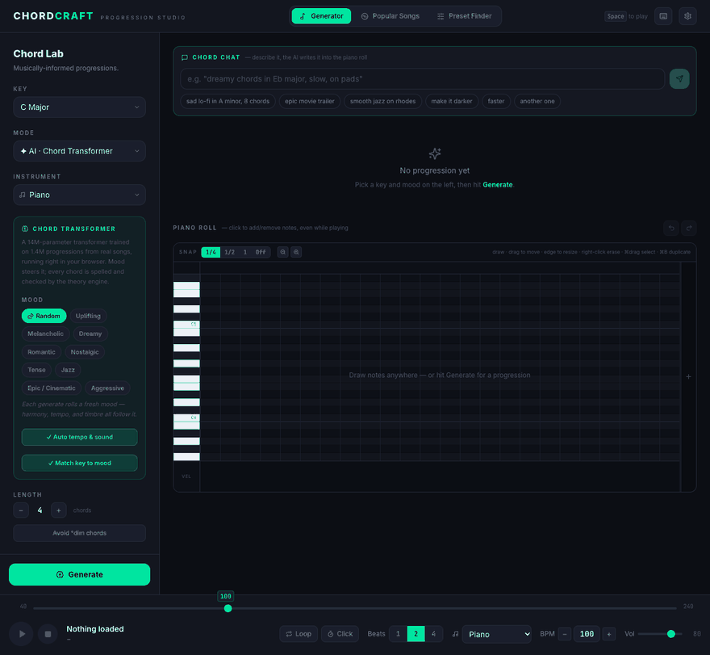
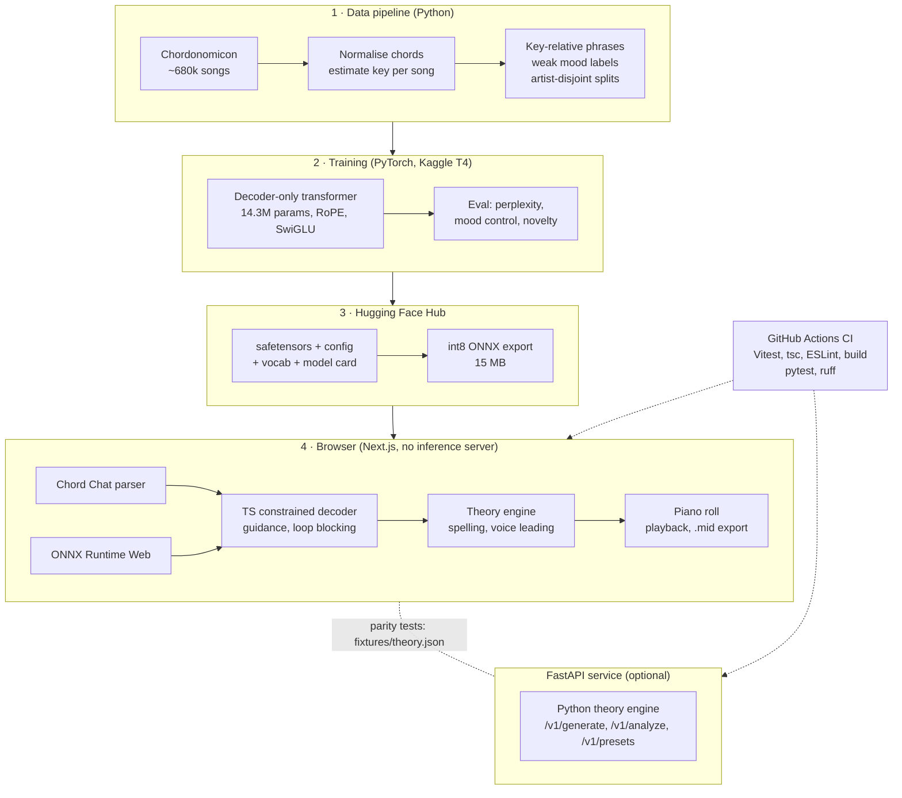

# ChordCraft

**Describe a chord progression in plain English and get playable MIDI, written by a 14M-parameter transformer I trained from scratch that runs entirely in your browser.**

**[▶ Try it live: chord-craft-live.vercel.app](https://chord-craft-live.vercel.app)**

[](https://github.com/ckeen302/ChordCraft/actions/workflows/ci.yml)
[](https://huggingface.co/ckeen302/chordcraft-chord-transformer)
[](LICENSE)



*Chord Chat on the live site: the request is parsed in the browser, the chord transformer writes eight chords into the piano roll, and "make it darker" re-generates them with a tenser mood.*

## Results

All numbers come from [`backend/results/`](backend/results) and the evaluation write-up in [backend/README.md](backend/README.md).

| What | Result |
| ---- | ------ |
| Language-model quality | **Test perplexity 4.12** over a 300-chord vocabulary (artist-disjoint test split, 77k phrases) |
| Mood control (1,800 progressions, 9 moods) | **90.4%** for the chord transformer with classifier-free guidance, vs **63.2%** for the hand-written rule engine (chance ≈ 11%) |
| Browser model | **int8 ONNX, 15 MB**, with **98.2% top-1 agreement** with the PyTorch model on 512 real validation prefixes |
| Repeated-loop bug | Outputs with an immediately repeated block (ii7–iii7–ii7–iii7) went from **53.6% → 0%** with decode-time loop blocking plus a presence penalty |

> **Caveat on mood control:** "mood" is a weak label produced by a rule-based labeler, and the model was trained on that labeler's output. The score shows that the mood conditioning works; it is not a human judgement of how sad or epic a progression sounds.

Training ran for 3 epochs on a free Kaggle Tesla T4 (8,292 steps, 72 minutes, $0).

## Architecture



## Technical decisions

- **Inference runs in the browser.** The live site has no inference server: the int8 model downloads once from the Hugging Face Hub and runs in ONNX Runtime Web, about 0.4 s per progression. Hosting costs nothing, there is no network round trip per generation, and the demo can't go down because a GPU endpoint is asleep. A free GPU-backed server was also ruled out because Hugging Face Docker Spaces now need a paid plan. The FastAPI service still exists for server-side use and shares the same theory engine.
- **Tokens are key-relative.** Chords are stored as scale degrees relative to the song's tonic (`0:m 8:maj 3:maj 10:maj`), not absolute names. "vi–IV–I–V" is one pattern rather than 12, so the 300-token vocabulary carries far more evidence per token, and any output can be spelled in any of the 24 keys afterwards. It also tolerates the key estimator's most common mistake, confusing a relative major and minor.
- **Classifier-free guidance controls mood.** Training drops the mood/genre conditioning 30% of the time, so the same model can also predict with `mood:any`. At decode time each step is pushed away from that unconditioned prediction (w = 2). This raised mood control from 83% to 90.4%, lifting the weakest moods (aggressive 64% → 96%), without retraining and without losing diversity (distinct-2 went up, 0.114 → 0.133).
- **Decoding is constrained, so every output is valid.** The decoder enforces exact length, no immediate repeats, and loop blocking, and the same sampler is implemented in Python and ported to TypeScript ([`lib/ai/sampler.ts`](lib/ai/sampler.ts)). The TypeScript and Python theory engines are pinned to ~500 shared golden cases in [`fixtures/theory.json`](fixtures/theory.json).

Model, data pipeline, evaluation and ONNX export are documented in [backend/README.md](backend/README.md).

## Getting started

```bash
npm install
npm run dev      # http://localhost:3000
```

No configuration or API keys required. Samples stream from a CDN on first play.

The AI mode downloads its model from the Hugging Face Hub on first load — nothing to configure.
The Python side (data pipeline, training, evaluation, and an optional FastAPI service) lives in
[`backend/`](backend/README.md).

## Scripts

| Command              | Purpose                       |
| -------------------- | ----------------------------- |
| `npm run dev`        | Dev server (localhost:3000)   |
| `npm run build`      | Production build              |
| `npm start`          | Serve the production build    |
| `npm run type-check` | TypeScript check              |
| `npm run lint`       | ESLint                        |
| `npm test`           | Vitest unit tests             |

> Note: don't run `npm run build` while a dev server is running — both write to `.next/` and the dev server's chunk manifest gets corrupted (ChunkLoadError). Stop the dev server first, or just rely on `type-check`.

## Features

- **AI · Chord Transformer** — progressions written by a 14M-parameter transformer trained from scratch in PyTorch on 1.4M real-song progressions, steered by mood and length. It runs **in the browser**: the int8 ONNX export (15 MB, [on the Hugging Face Hub](https://huggingface.co/ckeen302/chordcraft-chord-transformer)) executes in ONNX Runtime Web with constrained decoding ported to TypeScript (~0.4 s per progression, no server). Every chord is spelled, voice-led, and analysed by the theory engine. Model, data, and evaluation: [backend/README.md](backend/README.md).
- **Chord Chat** — describe what you want in plain English ("sad lo-fi in A minor, 8 chords", "epic trailer", "smooth jazz on rhodes") and the chord transformer writes it straight into the piano roll as MIDI, with a reply explaining the harmony. Refine it conversationally: "darker", "jazzier", "longer", "faster", "up a step", "make it resolve", "another one". Requests are parsed in the browser (moods and synonyms, style presets like lo-fi/trap/punk, keys, length, tempo, instrument).
- **Mood-true AI output** — classifier-free guidance (mood control 83% → 90%), keys that follow the mood (melancholic in C plays in C minor), and a mood colouring layer that gives the model's chords each mood's signature extensions.
- **Smart Generate** — a mood-driven harmony engine. Defaults to **Random**, rolling a fresh mood on every generate (shown as a badge, e.g. "🎲 Nostalgic"); pin one of the 9 moods (Uplifting, Melancholic, Dreamy, Romantic, Nostalgic, Tense, Jazz, Epic, Aggressive) to repeat it instead. Each blends signature progressions from real repertoire (doo-wop changes, ii–V–I turnarounds, the minor axis, sad-pop loops) with a weighted Markov chain over functional harmony, plus mood-specific cadences and chord extensions.
- **Fully Random & Classic Templates** — pure-chance diatonic progressions, or fixed patterns like I–V–vi–IV and ii–V–I.
- **Real sampled instruments** — 11 voices played from recorded multisamples via Tone.js (grand piano, acoustic guitar, organ, layered string/brass ensembles, harp, bass, bells) with an FM electric piano, pad, and lead. Root-octave doubling and humanized note onsets.
- **FL Studio–style piano roll** — a real note editor, not just a chord grid: every note has its own start, length, and velocity. Pencil-draw on empty cells, drag to move (whole selection follows), drag a note's right edge to resize, right-click to erase, ⌘drag for box selection, ⌘A/⌘C/⌘X/⌘V and ⌘B (duplicate right), Delete key, snap grid (1/4 · 1/2 · 1 · off), horizontal zoom, a velocity lane with draggable bars, full C1–B7 pitch range with scroll, and a beat-accurate playhead. Chord columns relabel themselves via chord detection as you edit, and playback follows edits live.
- **Popular Songs library** — 87 research-verified progressions with the record's real key, tempo, and per-chord harmonic rhythm.
- **Transport** — play/pause/stop (Space), loop, transport-tied metronome (M), live BPM 40–240, beats-per-chord, volume.
- **Export** — standards-compliant `.mid` files (correct tempo, beats-per-chord, and General MIDI program for the selected instrument), or copy the progression as text.
- **Undo / Redo** — every edit (generate, note edits, deletions, transpose) is undoable via buttons or ⌘Z / ⇧⌘Z.
- **Transpose** — shift the whole progression ±1 semitone; voicings, rhythm, and roman numerals survive, and the key select follows (all 24 keys covered).
- **Harmonic analysis** — an instant rule-based breakdown of every progression (cadence type, borrowed chords, named devices like the Phrygian bII or the IV→iv "saddest move").
- **Robust chord parsing** — 24 chord qualities including extended and altered chords (maj9, m11, 13, m7b5, 7♭9, 7♯9), common notations (Δ, ø, °, mM7), and a strict mode that rejects anything it would have to guess at.
- **Saved progressions** — name and keep favourites (exact voicings round-trip), separate from the auto-history of recent generations.
- **Settings** — persisted defaults for BPM, instrument, beats-per-chord, and volume, applied every launch.
- **Preset Finder** — a searchable library of 832 famous VST preset identifications ("what preset is that sound?") mined from solved [r/findthepreset](https://www.reddit.com/r/findthepreset/) threads, YouTube, and the web: full-text search, filter by VST or source, every entry labelled **Confirmed** (official documentation) or **Community ID** with a source link. It lives in SQLite with an FTS5 index (`backend/db/presets.sqlite`), is served by the FastAPI `/v1/presets` API, and a weekly GitHub Action ingests new threads and opens a PR. The deployed site reads an exported JSON snapshot and runs the same query in the browser.
- **Shortcuts reference** — keyboard icon in the header lists every transport key and piano-roll gesture.
- **No lost work** — both tabs stay live in the background: switch between Generator and Popular Songs without losing your progression, undo history, or selected song. Metronome accents follow each song's meter (3/4, 6/8, 12/8).

## Repo layout

```
app/                 Next.js App Router shell (SSR-safe; audio loads client-side only)
components/
  ChordCraftApp.tsx  Root layout: header, Chord Lab, transport bar
  chord-lab/         Generator UI, chord strip/cards
  piano/PianoRoll.tsx  Real-time MIDI roll
  layout/TransportBar.tsx
hooks/useTransport.ts  Note-level playback: lookahead scheduler over NoteEvents
                       (velocity, exact starts/lengths, loop, live BPM, playhead clock)
store/useStore.ts      Zustand store — pure state, no side effects
lib/
  theory/            Chord parsing, keys, harmony engine (moods, Markov, signatures),
                     transpose, rule-based analysis
  roll/notes.ts      NoteEvent model — chords ⇄ notes conversion, chord windows,
                     per-window chord detection
  audio/             Tone.js sample engine + metronome
  midi/              MIDI export (chord blocks or exact note events)
  ai/                In-browser chord transformer: ONNX Runtime Web loader, constrained
                     sampler (TS port of the Python decoder), theory post-processing
  data/              Popular-song progressions (87 songs), VST preset library
backend/             FastAPI service + Python port of the theory engine (see backend/README.md)
fixtures/theory.json Golden outputs pinning the TypeScript and Python engines together
```

## Roadmap — AI rebuild

ChordCraft is being rebuilt into an AI chord-progression generator:

- **Chord model** — ✅ custom decoder-only transformer in PyTorch, trained on Chordonomicon with mode/genre/mood/length control tokens and constrained decoding (v1: test perplexity 4.12, 82% mood control vs 63% for the rule engine).
- **LLM copilot** — a fine-tuned open model (Llama / Qwen, LoRA via Hugging Face PEFT + TRL) that turns natural-language requests into tool calls: generate, edit, analyze, search.
- **RAG** — sentence-transformer embeddings + FAISS over the song library for "sounds like…" requests.
- **Serving** — ✅ in-browser ONNX inference (int8, 15 MB); FastAPI service for the theory engine and server-side generation.
- **Evals** — rule engine vs. chord model vs. LLM-only, scored on validity, key adherence, and cadence quality.
- **Infra** — training on Modal and Kaggle GPUs, experiment tracking with W&B, models on the Hugging Face Hub, CI on GitHub Actions.

## License

Code is [MIT](LICENSE). The chord model is trained on [Chordonomicon](https://huggingface.co/datasets/ailsntua/Chordonomicon) (CC BY-NC 4.0), so the model weights inherit its non-commercial restriction.
